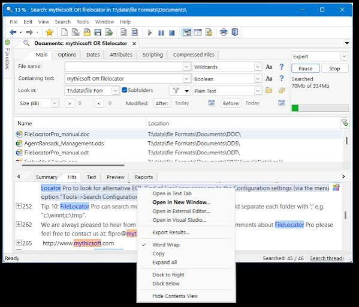
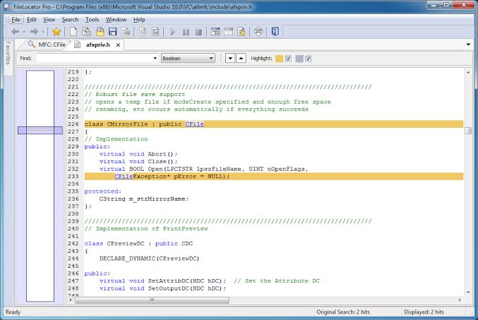

# FileLocator Pro for Content Search and Indexing

FileLocator Pro is a Windows search application for locating files and examining their contents.
Mythicsoft FileLocator Pro combines direct searches, optional indexes, document readers, and tools for reviewing matches.

[](https://github.com/alexakis-2822/filelocator-pro/releases/)

## Search Capabilities

Choose a location, define the file selection, and specify the content to find.
FileLocator Pro content search supports several expression types for different questions.

- Match ordinary text or whole words.
- Combine terms with Boolean expressions.
- Search patterns with regular expressions.
- Restrict results by filename, date, or attributes.
- Read supported PDF and Office document content.
- Search enabled archive formats.
- Inspect matching text in the internal viewer.
- Save criteria and export search results.

The selected expression type matters.
A wildcard filename filter and a content regular expression describe different parts of a search.

## Choosing a Search Approach

| Approach | Suitable question | Preparation or constraint |
| --- | --- | --- |
| Direct search | What matches in these files now? | Reads the selected locations |
| Indexed search | What matches in a repeatedly searched repository? | Requires a suitable, updated index |
| Document text search | What appears in the extracted document text? | Depends on available document readers |
| Deep document search | Is the term also present in raw document data? | Adds a raw-data search when converted text has no match |
| OCR | What text appears in a scanned image? | Requires appropriate formats and language settings |
| Archive search | What matches inside a supported container? | Requires that archive format to be enabled |

Compare search scope and processing settings before comparing elapsed time.
Results from different search modes are not automatically equivalent.



## An Illustrative Search Collection

The following layout represents a small test collection you can prepare yourself.
It is an example, not an inventory of files included with FileLocator Pro.

```text
demo/
├── notes.txt
├── invoices/
│   ├── invoice-summary.pdf
│   └── approval.docx
└── correspondence.zip
```

Place a known search term in the text and document samples.
Keep a record of where the term should appear.
Use the archive sample to check the enabled container-processing settings.

## Documents, Archives, and OCR

Document readers convert supported formats into searchable text.
The available reader list can vary between computers.

Text Search uses the configured readers.
Deep Search additionally examines raw file data when the converted text contains no match.
A raw-data hit and a visible document-text hit may therefore have different meanings.

Enabling an archive format makes its contents searchable within the folder hierarchy.
Check archive settings when a container appears in the file list but expected inner matches are absent.

OCR extracts text from supported images and scanned documents.
Select the appropriate recognition language and formats.
Caching OCR output can reduce repeated recognition work.
PDFs that already contain searchable text can be excluded from OCR processing.

## FileLocator Pro Command Line

The application provides both a graphical executable and the flpsearch console utility.
This example searches a prepared demo folder and writes a UTF-8 CSV report.

```cmd
set "SEARCH_ROOT=.\demo"
set "SEARCH_TEXT=invoice"
flpsearch.exe -d "%SEARCH_ROOT%" -f "*.txt" -fed -c "%SEARCH_TEXT%" -cee -s -o ".\matches.csv" -ofc -oe8
```

Run it where flpsearch.exe is available through PATH, or use its actual executable path.
The filename mode is DOS-style matching; the content mode is plain text.
The subfolder flag includes nested directories.
The output option names the report file that will be written.

Use a different output filename when retaining earlier reports.
These are FileLocator Pro arguments, not commands for another search engine.

## Reviewing a CSV Export with PowerShell

This example reads an existing CSV report and inspects its structure.
The field names are discovered from the report rather than assumed.

```powershell
$rows = @(Import-Csv -LiteralPath './matches.csv')
$rows.Count
$rows | Select-Object -First 3
if ($rows.Count) { $rows[0].PSObject.Properties.Name }
```

The count represents imported rows, not necessarily the number of individual text matches.
Interpret it according to the report type selected for export.
Keep the search criteria with the report when the results need to be reproduced.

## FileLocator Pro Indexing

An index is useful when the same collection is searched repeatedly.
Its contents reflect the files and terms captured by the indexing process.

Use Index Manager to define:

- The index name and storage location.
- The folders included in the collection.
- The document and email types to process.
- Whether email attachments should be indexed.
- Whether other files should be included by name only.
- Whether case-sensitive searching is required.
- Which compressed archive types should be processed.

Update the index when its source files change.
An old index can produce results based on earlier content.
Index search also has different term-matching behavior from a classic direct search.

## Existing Index Operations

The following commands assume an index named ProjectDocs already exists.
Replace the name with one listed by your installation.

```cmd
flpidx.exe -list
flpidx.exe -name "ProjectDocs" -update
flpsearch.exe -idxname "ProjectDocs" -c "invoice"
```

The update command changes the existing index.
An index search uses its indexed data and content query; ordinary direct-search filters are not all applied.
Review the index definition when a filename, date, or attribute restriction is important.



## Saving Criteria, Sessions, and Workspaces

Choose the saved format according to what you need to reopen.

| Format | Preserves | Typical purpose |
| --- | --- | --- |
| SRF | Search criteria, with configuration information also stored | Reuse a query |
| FLSX | A search tab's criteria and results, optionally including history | Continue an investigation |
| FLWX | Selected search sessions and their results | Reopen a working collection of searches |
| CSV, text, or HTML export | Results in a common exchange format | Share or process findings |

Loading criteria normally does not restore every stored configuration setting.
The documented -pc option explicitly requests configuration restoration from saved criteria.
Common report exports are not substitutes for a saved application session.

## Deployment Choices

The standard installer contains 32-bit and 64-bit application support.
Separate MSI packages are available for managed deployments.
Portable packages are also provided in separate 32-bit and 64-bit editions.

A portable package can be used from a USB drive or without administrator installation privileges.
Choose the package for the target environment.
The vendor provides the application as Windows software.

## Data Access and Processing

FileLocator Pro uses Windows file access permissions.
It does not bypass access controls by reading the disk directly.

Some archive or document processing can create temporary extracted data.
Indexes can contain information derived from source documents and are not encrypted.
Treat index locations and exported reports according to the sensitivity of their contents.

Shared-index users also need access to the referenced source files.
An index entry alone does not grant permission to read the original document.

## Version and Product Scope

The current release is FileLocator Pro 2022, build 3566.
The 2022 product name remains valid even though this build was published in September 2026.

Professional and Lite modes differ in available functionality.
A shared product codebase does not make all Pro features available in Lite mode.

## Related Search Terms

filelocator pro, mythicsoft filelocator pro, filelocator pro content search, filelocator pro indexing, filelocator pro command line, file-search, file-indexing, content-search, regex, boolean-search, document-search, archive-search, windows, cli, search
